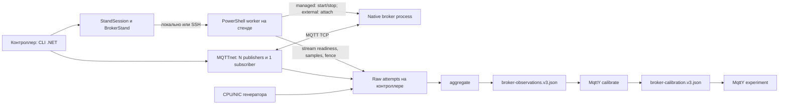
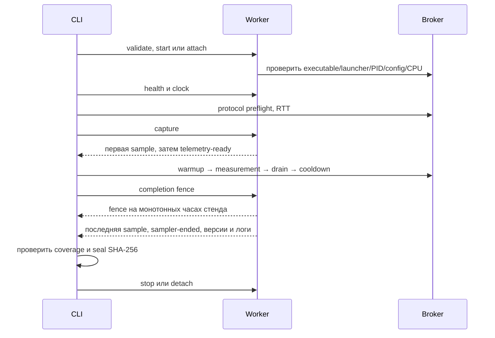

# Архитектура запуска и сбора метрик

Стенд разделяет жизненный цикл брокера, протокольную нагрузку и доказательства измерения. Один компьютер совмещает роли; на двух компьютерах worker работает на broker host, а CLI и MQTTnet — на контроллере. Все маршруты используют один контракт v3. При 3+ машинах nativeHost/dockerContext выбираются по broker entry; matrix остаётся последовательной. [Варианты размещения](deployment-layouts.md).

## Последовательность одного измерения

Warmup исключён из измеряемых счётчиков. Drain даёт доставкам завершиться; итоговое окно и его причина записываются, а не восстанавливаются из номинальных 30 секунд. Fence должен предшествовать последней sample **на тех же монотонных часах broker host** и иметь тот же unitId. Синхронизация realtime и доказательство monotonic coverage — разные проверки.

## Локально и по SSH

StandSession хранит исходный инвентарь и создаёт snapshot выбранного брокера. BrokerStand управляет процессом и читает его ресурсы. RemoteNativeStand передаёт snapshot worker по зашифрованному SSH; большой payload идёт через stdin, компактный bootstrap — через EncodedCommand, чтобы учитывать ограничения Windows command line.

Телеметрия передаётся потоком: первая строка сохраняется до публикации local readiness. Лишь копирование файлов после завершения capture не обеспечило бы этот барьер. Worker сохраняет копии evidence в workRoot; frame receiver принимает безопасные относительные пути и не подменяет уже опубликованные байты. Capture и fence могут выполняться параллельно, но пишут разные итоговые артефакты.

На одном контроллере lease привязан к context; на SSH host дополнительно используется owner lease в workRoot. У каждого автоматического StandSession свой owner даже при одинаковых путях на разных контроллерах. Managed-процесс остановится при штатном выходе; external-процесс остаётся оператору. После потери SSH требуется recovery по [runbook](two-machine-stand.md).

## Где находится реализация

| Ответственность | Источник |
|---|---|
| CLI и выбор схемы | [Program.cs](../src/EntityFX.MqttBenchmark.Cli/Program.cs) |
| Команды, identity, параметры | [Commands](../src/EntityFX.MqttBenchmark.Campaign/Commands/) |
| Session, lifecycle, telemetry barriers | [Stand](../src/EntityFX.MqttBenchmark.Campaign/Stand/) |
| Локальный process controller | [BrokerStand.ps1](../scripts/BrokerStand.ps1) |
| SSH transport, streaming и host lease | [RemoteNativeStand.ps1](../scripts/RemoteNativeStand.ps1) |
| Нагрузка, ledger и drain | [Workload](../src/EntityFX.MqttBenchmark.Campaign/Workload/) |
| CPU/NIC контроллера | [Guard](../src/EntityFX.MqttBenchmark.Campaign/Guard/) |
| Агрегация | [CampaignAggregator.cs](../src/EntityFX.MqttBenchmark.Campaign/CampaignAggregator.cs) |

Установка и режим запуска не определяют качество профиля сами по себе. Топология, observer overhead, subscriber, resource enforcement и сетевой путь остаются частью установки. Формулы и scopes — в [метриках](metrics.md), точные CLI/options — в [контракте кампании](campaign-v3.md).
